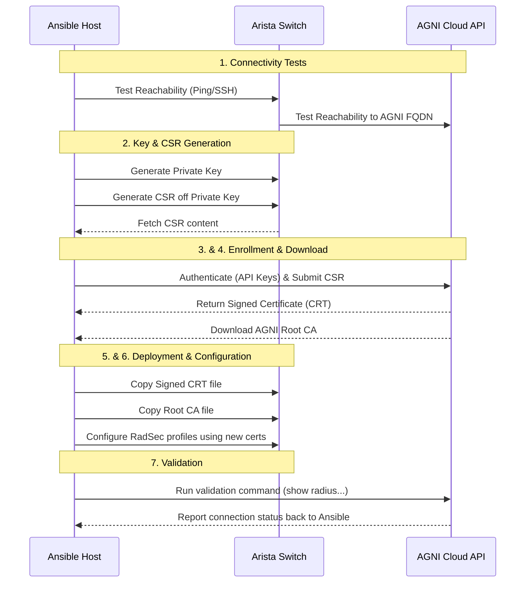

# Arista AGNI Certificate Deployment

This role automates the generation and signing of certificates for Arista switches using Arista AGNI. It handles the full lifecycle from connectivity checks to certificate deployment and validation.

## Workflow Overview

The following sequence diagram illustrates the automation flow between the Ansible control host, the target Arista switch, and the AGNI cloud service.



The role performs these specific tasks sequentially:

1. **Connectivity Check:** Verifies connectivity from Host to Switch and Switch to AGNI.
2. **Key Generation:** Connects to switches to create a Certificate Key and CSR.
3. **Enrollment:** Connects to AGNI, enrolls the device using the CSR creating a CRT.
4. **Download:** Retrieves the signed CRT and ROOT CA from AGNI.
5. **Deployment:** Copies the CRT and ROOT CA to the switches.
6. **Configuration:** Configures RadSec certificates on the switch.
7. **Validation:** Validates the active connection to AGNI.

---

## Setup & Prerequisites

Before running the playbook, ensure you have a user with appropriate privileges on the device and the necessary AGNI API credentials.

### 1. Environment Variables

Create a `.env` file to store sensitive variables so they are not hardcoded in your playbooks.

**File:** `.env`

```bash
# .env variable file
# Switch Credentials
export LABPASSPHRASE="changeme" 

# AGNI API Credentials
export AGNI_keyID=KEY-ATNXXXXX-XXX # From Arista Launchpad
export AGNI_keyValue=XXXXXXXXXXXXXXXXX # From Arista Launchpad
# From AGNI GUI User profile upper right > "Copy Organization ID"
export AGNI_orgID=XXXXXXXXX-XXXX-XXXX-XXXX-XXXXXXXXXXXX 
export AGNI_pod=0 
```

### 2. Source the Environment

Load the variables into your current shell session before running ansible commands:

```bash
source .env
```

---

## Inventory Configuration

The default ANSIBLE group used by the role for targeting is **`AGNI_CERTIFICATES`**. Below is an example of how to structure your inventory to select specific subgroups for deployment.

```yaml
all:
  children:
    PROD:
      children:
        EASTCOAST_FABRIC:
          children:
            BLUE_SPINES:
              children:
                SITE1_BLUE_SPINES:
                  hosts:
                    SW101-SITE1-B:
                      ansible_host: 172.20.20.10
                      inband_ip: 10.126.1.111
            # ... [truncated for brevity] ...
            PURPLE_LEAFS:
              children:
                SITE3_PURPLE_LEAFS:
                  hosts:
                    SW301-SITE3-P:
                      ansible_host: 172.20.20.42
# Define the target group for this role
    AGNI_CERTIFICATES:
      children:
        PURPLE_LEAFS: null
        RED_LEAFS: null
        # BLUE_LEAFS: null # Commented out groups will be skipped
```

---

## Role Defaults

These variables control the behavior of the role. You can override these in your playbook, inventory, or extra vars.

```yaml
---
# defaults file for agni-certificates
#
# Input/Output directories
certificate_folder: "{{ root_dir | default(inventory_dir) }}/certificates"
certificate_csr_folder: "{{ certificate_folder }}/csr"

# VRF for switch-originated ping, DNS, and RadSec traffic.
# Keep `default` for devices without a management VRF.
agni_device_vrf: default

# Toggles (Enable/Disable specific tasks steps)
agni_ping: true              # Bypass Ping check if false
agni_csr: true               # Create key and CSR on switch
agni_api: true               # Sign CSR from AGNI CA via API
agni_deploy: true            # Copy Certs to Switch
agni_cfg_switch: true        # Configure AGNI radsec on switch
agni_validation_report: true # Validation and report of AGNI Status (1 minute timeout)

#
# AGNI API URL Configuration
agni_fqdn: "beta.agni.arista.io"
agni_base_url: "https://{{ agni_fqdn }}"
agni_login_endpoint: "/cvcue/keyLogin"

# CSR Country Abbreviation
agni_cert_signing_country: CA

# Ansible User and password for switch connection
ansible_user: cvpadmin
# It is recommended to pass the password via an encrypted method or env var
ansible_password: "" 

# AGNI API Login and org ID defaults (Override these with env vars usually)
agni_api_keyid: KEY-ATNXXXXX-XXX
agni_api_keyvalue: XXXXXXXXXXXXXXXXX
agni_api_orgid: XXXXXXXXX-XXXX-XXXX-XXXX-XXXXXXXXXXXX
```

---

## Install

Install necessary requirements (e.g., Arista AVD collection if needed) using Ansible Galaxy:

```bash
ansible-galaxy install -g -f -r example/requirements.yml
```

---

## Example Playbook

Create a playbook to utilize the role. This example uses the `AGNI_CERTIFICATES` group defined in the inventory and looks up necessary credentials from the environment variables sourced earlier.

**File:** `agni-certificates.yml`

```yaml
---
- name: Arista AGNI Certificate Deployment
  hosts: "{{ target_hosts | default('AGNI_CERTIFICATES') }}"
  gather_facts: false
  # ignore_unreachable: true

  tasks:
    - name: Generate and Deploy Arista AGNI Certificates
      vars:
        ansible_user: cvpadmin
        # Lookup credentials from environment variables defined in .env
        ansible_password: "{{ lookup('env', 'LABPASSPHRASE') }}"
        agni_api_keyid: "{{ lookup('env', 'AGNI_keyID') }}" 
        agni_api_keyvalue: "{{ lookup('env', 'AGNI_keyValue') }}" 
        agni_api_orgid: "{{ lookup('env', 'AGNI_orgID') }}" 
        agni_api_zoneid: 0
      ansible.builtin.import_role:
        # Ensure the role name matches your directory structure
        name: agni-certificates
```

## Execution

Run the playbook against your inventory:

```bash
# Setup Switches with AGNI Certs
ansible-playbook agni-certificates.yml -i inventory.yml
```

## Todo

 - Support for linux hosts
 - If the device is not in AGNI then add it. (CVP auto adds the devices into AGNI if "Installed apps is setup correctly")